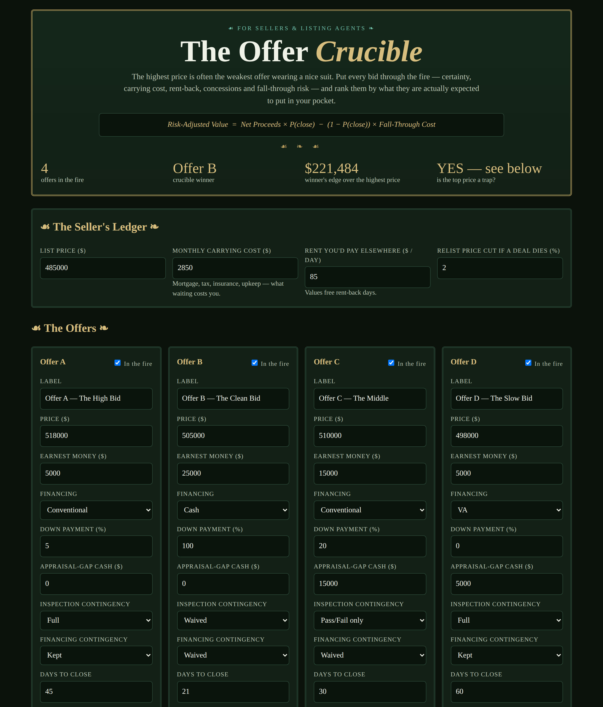

# The Offer Crucible — Test Every Offer in the Fire

**Live:** https://thebullbrew.github.io/offer-crucible/

The highest price is often the weakest offer wearing a nice suit. For sellers and listing
agents drowning in a multiple-offer weekend, the Crucible ranks every bid by **risk-adjusted
value** — what it is actually expected to put in the seller's pocket — not by its headline.

## What it does

- **The Seller's Ledger** — list price, monthly carrying cost, the rent you'd pay elsewhere
  (which values free rent-back days), and the relist price cut you'd eat if a deal dies.
- **Four offers in the fire** — price, earnest money, financing type, down payment,
  appraisal-gap cash, inspection and financing contingencies, days to close, free rent-back
  days, and concessions asked, each editable and toggleable.
- **The Assay** — every offer gets a Net (price − concessions − carrying cost to closing +
  rent-back value), a structured Certainty score with a visible points breakdown for every
  factor, and a Risk-Adjusted Value. Ranked table, winner first.
- **The Highest-Price Trap** — when the top headline bid loses, the Crucible says so in
  dollars and shows exactly why: contingencies, time, and fall-through risk, priced.
- **What If the Fire Cools?** — a sensitivity table repricing every offer at 50% / 70% /
  90% closing odds. Fragile offers fall fast; sturdy ones barely move.
- **Saved comparisons and copy summary** — localStorage saves for round two of
  negotiations, plus a one-click text summary to send the seller.

## The method behind it

Risk-Adjusted Value = Net × P(close) − (1 − P(close)) × Fall-Through Cost, where the
fall-through cost is 60 extra days of carrying plus your relist price cut. Certainty is
built from the things that actually kill deals: financing type (cash removes the lender),
earnest money as a share of price (skin in the game), waived contingencies (fewer exit
doors), appraisal-gap cash, down payment, and speed to close. Two rules: a headline price
is not a net, and time is a line item — every extra week to closing comes out of the
seller's pocket whether the offer admits it or not.

## Run it

No backend, no build step. Open `docs/index.html` in any browser (works from `file://`),
or serve the folder statically. Installable as a PWA — works offline.

Built with dark old-money styling (Alchemist's Desk variation) in the daily-apps series.
